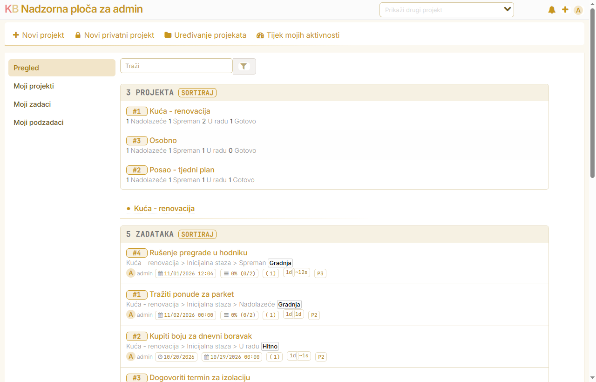

# YanNix Theme

A modern, flat skin for [Kanboard](https://kanboard.org). Local Inter font, a warm
paper light theme and a gold-on-navy dark theme, single hairline borders, no shadows,
line icons, and a sidebar that marks state with shading only.



## What it changes

- **Type** — Inter Variable served from the plugin folder (no CDN, works offline), base 16.5px
- **Surfaces** — one 1px border per surface, 6px radius, every `box-shadow` removed
- **Sidebar** — no left bars or dotted markers; hover and active state are shading only
- **Tables and lists** — the outer frame is the only frame, rows are separated by a hairline
- **Chips and avatars** — one hairline in the accent color, no double frame
- **Two palettes** — light (`--page: #fbf8f0`) and dark (`#14142a`) keyed on Kanboard's `theme-dark` class
- **Focus** — a 2px accent outline instead of a shadow ring, so keyboard focus stays visible

## Install

1. Copy the `YanNixTheme` folder into `plugins/` of your Kanboard installation:

   ```
   kanboard/
     plugins/
       YanNixTheme/
         Plugin.php
         Assets/css/yanix-theme.css
         Assets/fonts/InterVariable.woff2
   ```

2. Reload Kanboard. The theme is applied automatically; there is nothing to configure.
   It appears in **Settings → Plugins** as *YanNix Theme 1.0.0*.

## Uninstall

Rename or delete `plugins/YanNixTheme`. Kanboard returns to its stock look — no core
file was modified, so nothing else has to be undone.

## Compatibility

Kanboard **>= 1.2.47** (tested on 1.2.56). The stylesheet is loaded last through the
`template:layout:css` hook, so it wins over the active theme without `!important`
fights.

## Notes

- The dark palette follows Kanboard's own theme switch (`Settings → Application → Theme`).
- Column and status colors come from Kanboard; the theme only changes how they are framed.
- This folder is a plain skin: it ships CSS and a font, no PHP logic beyond the hook.

## License

MIT — see [LICENSE](LICENSE).
